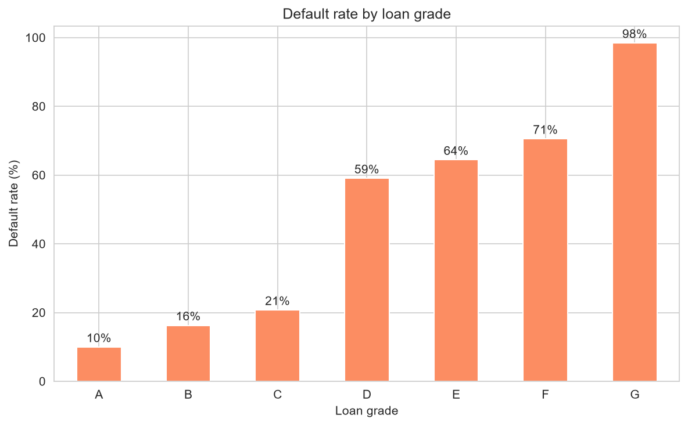
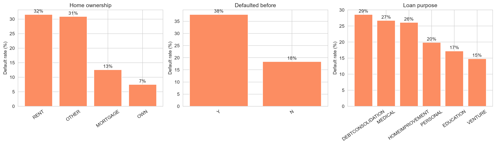
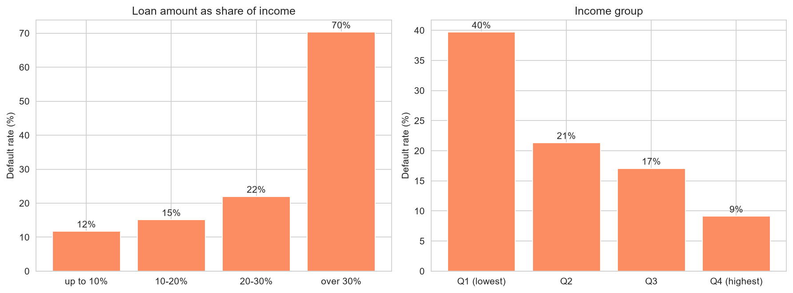
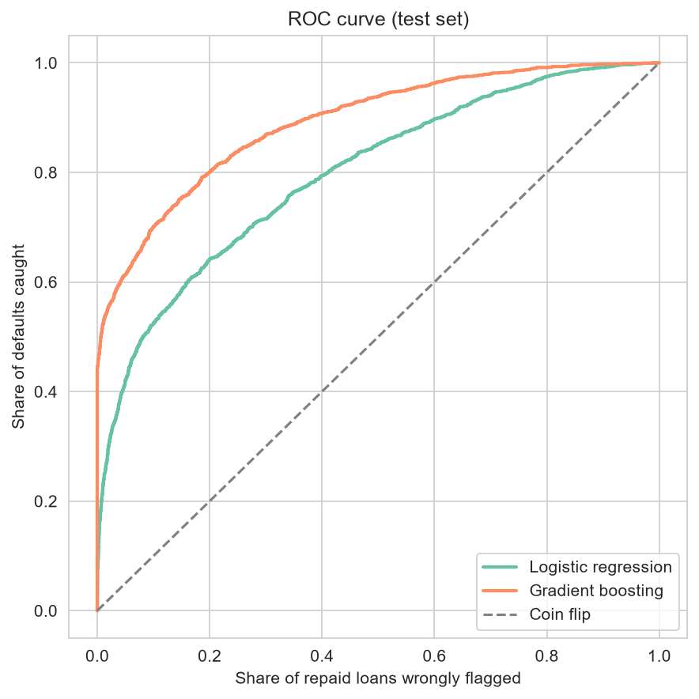
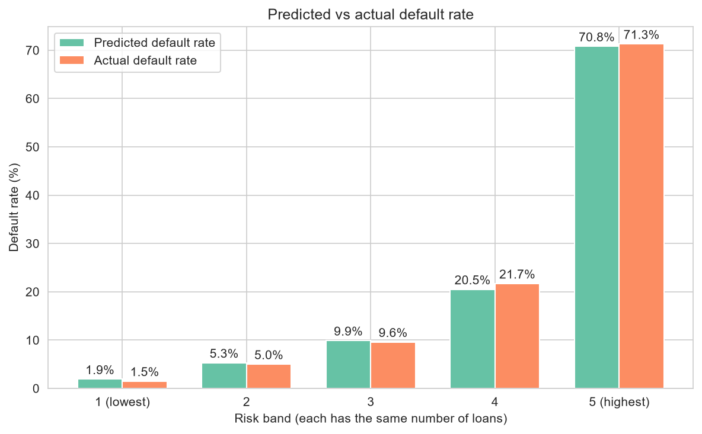
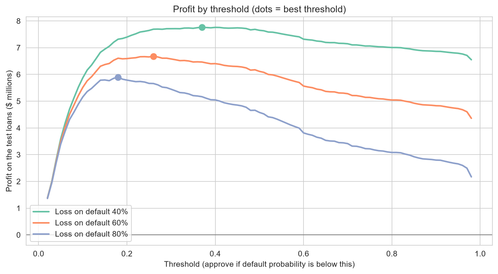

# Credit Risk: Which Loans Should a Lender Approve?

Analysis of 32,581 loan applications. It checks the data, finds what drives defaults, builds a model that predicts default, and uses the model to choose an approval cut-off by looking at profit and not only accuracy.

## Executive Summary

- **21.8% of the loans default.** Approving every loan loses money (about -$0.72M on the test loans), because the defaults cost more than the interest the other loans pay.
- **A model fixes this.** Gradient boosting separates good and bad loans well (AUC 0.891, and 0.900 in cross-validation). Used at the usual 0.50 cut-off it turns the loss into a profit of about **$6.12M**.
- **Choosing the cut-off from profit adds 9% more.** At a cut-off of 0.26 the profit is **$6.68M**. It approves 76.5% of the loans, and only **8.4% of the approved loans default** (vs 21.8% overall).
- **The right cut-off depends on how much a default costs:** 0.37 if 40% of the loan is lost, 0.26 at 60% and 0.18 at 80%. The real loss per default is the first number to get from the finance team.
- **The biggest default signals:** a loan above 30% of the borrower's income (70.3% default, vs 11.7% under 10%), low income (39.7% in the lowest group vs 9.1% in the highest), renting (31.6% vs 7.5% for owners) and a previous default (37.8% vs 18.4%).
- **Two kinds of columns are left out on purpose.** The lender's own grade and interest rate would inflate the result (AUC 0.891 to 0.937) because they are set after the risk is judged. The added columns (gender, marital status, education, country and others) have no link to default and should not be used in lending anyway.

## Terms

- **Default:** the borrower does not repay the loan.
- **Default probability:** the model's estimate, from 0 to 1, that a loan will default.
- **Threshold (cut-off):** a loan is approved only if its default probability is below this number.
- **AUC:** how well the model ranks risky loans above safe ones. 0.5 is a coin flip and 1.0 is perfect.
- **Precision and recall:** of the loans the model flags as defaults, how many really default (precision). Of all real defaults, how many the model catches (recall).
- **LGD (loss given default):** the share of the loan amount the lender loses when a loan defaults. Assumed to be 60%.

## Business Questions

| Question | Short answer |
|---|---|
| Can the data be trusted? | Mostly. A few impossible values and two columns with missing data (see Data Quality) |
| What drives default? | Loan size vs income, income, home ownership, previous default, loan purpose |
| Can we predict default? | Yes, AUC 0.891 using only what is known at application time |
| Where should the approval cut-off be? | 0.26 with a 60% loss per default, and it moves with that loss |
| Does the model treat groups differently? | Approval rates are close across gender and country; education shows a 4-point gap, probably chance |

## Dataset

- **Source:** DataDNA Dataset Challenge, Credit Risk Dataset (Onyx Data, September 2025). It looks like a well-known public credit risk dataset with extra columns added later (gender, country, open accounts and others).
- **File:** `data/credit_risk.csv`, the sheet "Credit Risk Data" of the challenge workbook saved as CSV (one column renamed from `client_ID` to `client_id`).
- **Size:** 32,581 loans and 29 columns. 32,574 loans remain after removing 7 impossible rows.
- **Target:** `loan_status` (1 = default, 0 = repaid).

## Tools

Python, Pandas, scikit-learn (logistic regression, gradient boosting), Matplotlib, Seaborn, Jupyter Notebook

## Key Insights

### What drives default



Default rates climb with the lender's grade, from 10.0% for grade A to 98.4% for grade G, with a big jump between C (20.7%) and D (59.0%). The grade is set after the risk is judged, so it is not used to predict default.



- **Renting** (31.6%) is four times riskier than owning (7.5%). A **previous default** doubles the risk (37.8% vs 18.4%).
- **Debt consolidation** (28.6%) and medical loans (26.7%) default more than venture (14.8%) and education loans (17.2%).



- The **loan amount compared with income** matters most: 11.7% default below 10% of income, 22.0% at 20 to 30%, and 70.3% above 30%.
- **Lower income** means higher risk: 39.7% in the lowest group vs 9.1% in the highest.
- Loan term (20% to 22%) and age (20% to 23%) make almost no difference.

### The model

| Model | AUC (test) | AUC (5-fold CV) | Precision at 0.5 | Recall at 0.5 |
|---|---|---|---|---|
| Logistic regression | 0.797 | 0.805 | 0.726 | 0.387 |
| Gradient boosting | 0.891 | 0.900 | 0.920 | 0.533 |



At the usual cut-off of 0.5, 92% of the loans the model flags really default, but it only catches 53% of all defaults, so that cut-off is not necessarily the best one for a lender.



The predicted default rates are close to the real ones in every risk band (for example 70.8% predicted and 71.3% actual in the riskiest band). This matters because the profit calculation uses the probabilities themselves.

The model relies most on income, loan size compared with income, home ownership, loan purpose and previous default (see `images/feature_importance.png`).

**Leakage check (AUC with the same model and different columns):**

| Columns | AUC (test) |
|---|---|
| Application data only (used in the model) | 0.891 |
| + loan grade and interest rate | 0.937 |
| + the added columns (gender, country, debt and others) | 0.885 |

The grade and interest rate make the model look better, but the lender chooses them after judging the risk, so they are not available when the decision is made. The added columns do not help.

### Where to set the cut-off

A loan is approved when its default probability is below the threshold. A low threshold is safer but rejects good customers. A high threshold earns more interest but takes more losses.



| Strategy (loss on default 60%) | Approval rate | Default rate of approved | Profit on test loans |
|---|---|---|---|
| Approve every loan | 100.0% | 21.8% | -$0.72M |
| Model, threshold 0.50 | 87.4% | 11.7% | $6.12M |
| Model, threshold 0.26 | 76.5% | 8.4% | $6.68M |

| Loss on default | Best threshold | Approval rate | Default rate of approved | Profit with model | Profit approving all |
|---|---|---|---|---|---|
| 40% | 0.37 | 83.2% | 10.3% | $7.76M | $3.16M |
| 60% | 0.26 | 76.5% | 8.4% | $6.68M | -$0.72M |
| 80% | 0.18 | 67.6% | 6.6% | $5.90M | -$4.61M |

Assumptions: a repaid loan earns the interest of the whole loan with standard monthly payments, a rejected loan earns and loses nothing, missing interest rates use the median, and running costs are ignored. The numbers are for the 8,144 test loans and are meant for comparing choices, not as a forecast.

### Fairness check

The model never sees gender, marital status, education, country or employment type. Approval rates at the 0.26 cut-off are still close: 77.0% for women and 76.0% for men, and 75.4% to 77.6% across the three countries. The widest gap is by education (Master 79.5% and PhD 79.3% against High School 75.2%). Education has no link to income or loan size in this data, so the gap is most likely chance, but it is the first thing to check on real customers.

## Data Quality

| Check | Result |
|---|---|
| Duplicate rows | 0 |
| Missing `person_emp_length` | 895 loans (these default more: 31.5% vs 21.5%) |
| Missing `loan_int_rate` | 3,116 loans |
| Age above 100 (ages 123 and 144, the record is 122) | 5 rows, dropped |
| Employment length above 60 years (123 years, applicants aged 21 and 22) | 2 rows, dropped |
| Income above $1M | 9 rows. The highest ($6M) belongs to a dropped 144-year-old applicant, the other 8 (up to $2.04M) are kept |
| Employment longer than age minus 14, or credit history longer than age minus 16 | 2 rows (the same 123-year rows) and 0 rows |

A missing employment length carries information, so the model keeps a "was missing" flag. The added columns show almost no link with default: for example the default rate only moves between 21.8% and 21.9% by gender.

## Recommendations

1. **Use the model, but choose the cut-off from profit.** Approving everything loses money, the model turns that into a profit, and a profit-based cut-off adds about 9% more than 0.50.
2. **Get the real cost of a default** before fixing the threshold. It moves the best cut-off from 0.37 to 0.18.
3. **Look closely at loans above 30% of income, renters and applicants with a previous default.** They have the highest default rates (70.3%, 31.6% and 37.8%).
4. **Do not use the lender's own grade or interest rate as model inputs,** and do not use gender, marital status or country.

## Limitations

- The added columns look simulated, and the loan results come from a public-style dataset, so real results will differ.
- The profit numbers rest on assumptions (LGD, interest earned over the full term, no costs, a loan defaulting at the start). They are good for comparing choices, not for forecasting.
- The test set is one random split of 8,144 loans. Cross-validation shows the model is stable, but there is no check on new time periods.
- A missing employment length is treated as information. If the data collection changes, this flag could stop working.

## Repository Structure

```
├── data/
│   └── credit_risk.csv
├── notebooks/
│   └── credit_risk_analysis.ipynb
├── images/
├── requirements.txt
└── README.md
```

## How to Run

1. Install the packages: `pip install -r requirements.txt`
2. Open the notebook: `jupyter notebook notebooks/credit_risk_analysis.ipynb`
3. Click Kernel, then Restart & Run All. The notebook reads `../data/credit_risk.csv` and saves the charts to `../images/`.

The outputs are already saved in the notebook, so it can be read on GitHub without running it.
